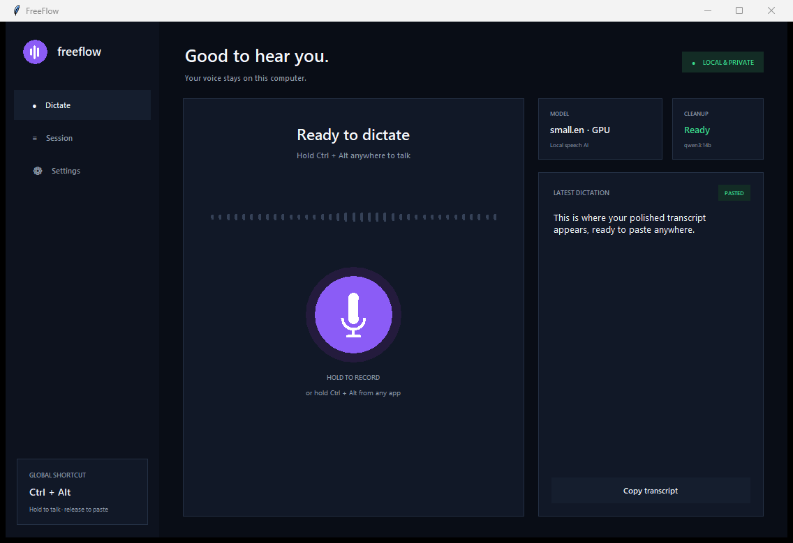

<div align="center">
  
  <h1>FreeFlow</h1>
  <p><strong>Private, on-device voice dictation for Windows.</strong></p>
  <p>Hold a shortcut, speak naturally, and release. FreeFlow transcribes, polishes, and pastes.</p>
</div>

> [!NOTE]
> FreeFlow is an independent open-source project. It is not affiliated with or
> endorsed by Wispr Flow.



## Why FreeFlow

- **Local transcription** — faster-whisper runs on your computer.
- **Optional local cleanup** — Ollama fixes punctuation, fillers, and light grammar.
- **Works everywhere** — the global hold-to-talk shortcut pastes into any Windows app.
- **Fast on NVIDIA GPUs** — CUDA is detected automatically, with a CPU fallback.
- **No audio archive** — microphone audio stays in memory and is discarded after transcription.
- **Useful native UI** — live input level, status, session history, and settings in one place.

## Requirements

- Windows 10 or Windows 11
- A working microphone
- Optional: [Ollama](https://ollama.com/) for transcript cleanup
- Python 3.11 or newer only when installing from source
- Optional: an NVIDIA GPU when installing from source

## Install

### Windows installer (recommended)

1. Open the [latest release](https://github.com/cartovgui-star/freeflow/releases/latest).
2. Download **`FreeFlow-Setup-1.0.0-x64.exe`**.
3. Run the installer, then open **FreeFlow** from the Start menu.

The installer is self-contained: Python is not required. It installs only for
the current Windows user, so administrator access is not needed. The packaged
build favors CPU compatibility; advanced users who want bundled NVIDIA
dependencies should use the source installation below.

> [!IMPORTANT]
> The installer is not code-signed yet, so Windows SmartScreen may display an
> "unrecognized app" warning. Verify the download against the `.sha256` file
> attached to the same GitHub release.

### Install from source

1. Download or clone this repository.
2. Double-click **`setup.bat`**.
3. Open **FreeFlow** from the desktop.

The setup script creates an isolated virtual environment, detects whether
NVIDIA acceleration is available, installs the appropriate dependencies,
checks the installation, creates a desktop shortcut, and launches FreeFlow.

To force a CPU-only installation:

```powershell
powershell -ExecutionPolicy Bypass -File .\setup.ps1 -CpuOnly
```

To also start FreeFlow with Windows:

```powershell
powershell -ExecutionPolicy Bypass -File .\setup.ps1 -StartWithWindows
```

The first launch downloads the selected Whisper model. `small.en` is the
default because it offers a good speed/accuracy balance.

## Use

1. Put your cursor in any text field.
2. Hold **Ctrl + Alt** and speak.
3. Release either key.
4. FreeFlow transcribes locally, optionally polishes the text with Ollama, and pastes it.

The dashboard record button works slightly differently: hold it to record and
release to copy the result. This avoids pasting back into FreeFlow itself.

### Configurable options

- Hold-to-talk shortcut
- Microphone input
- Whisper model (`tiny.en`, `base.en`, `small.en`, or `medium.en`)
- Ollama cleanup and model name
- Clipboard restoration
- Minimized startup

Source installations store settings in the repository's local `settings.json`.
Packaged installations store them in `%LOCALAPPDATA%\FreeFlow\settings.json`.

## Ollama cleanup

FreeFlow works without Ollama and falls back to the raw transcript. To enable
cleanup, install Ollama and pull the model configured in Settings:

```powershell
ollama pull qwen3:14b
```

The cleanup request is sent only to `http://localhost:11434`.

## Privacy

- Audio is kept only in memory while a dictation is being processed.
- Transcription runs locally through faster-whisper.
- Cleanup uses the local Ollama server.
- Session history is not persisted and disappears when FreeFlow exits.
- Clipboard contents are restored after pasting when that setting is enabled.

See [SECURITY.md](SECURITY.md) for responsible vulnerability reporting.

## Development

```powershell
py -3.11 -m venv .venv
.\.venv\Scripts\python -m pip install -r requirements.txt
.\.venv\Scripts\python freeflow.py
```

For NVIDIA acceleration:

```powershell
.\.venv\Scripts\python -m pip install -r requirements-gpu.txt
```

Validation and UI preview:

```powershell
.\.venv\Scripts\python -m py_compile freeflow.py
.\.venv\Scripts\python freeflow.py --smoke-test
.\.venv\Scripts\python freeflow.py --demo
```

Build the self-contained Windows installer:

```powershell
winget install --id JRSoftware.InnoSetup -e
.\packaging\build.ps1
```

The installer and its SHA-256 checksum are written to `dist\installer`.

## Project layout

```text
freeflow.py              Desktop UI and dictation engine
setup.ps1 / setup.bat    Windows installer and shortcut creation
run*.bat / run_silent.vbs Launchers
requirements*.txt        CPU and optional NVIDIA dependencies
assets/                  Brand assets
docs/                    Architecture and screenshots
packaging/               Self-contained app and installer build
.github/                 CI, issue forms, and contribution templates
```

## Contributing

Issues and pull requests are welcome. Start with [CONTRIBUTING.md](CONTRIBUTING.md)
and read [CODE_OF_CONDUCT.md](CODE_OF_CONDUCT.md).

## License

FreeFlow is available under the [MIT License](LICENSE).
